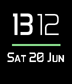

<!-- Generated by scripts/update_app_directory.py: do not edit by hand -->
[← All Pebble Developers](../developers.md)

# Jean-Noel Goumain

*1 watchface · Last updated 2026-10-11 · [About these lists](../about-app-lists.md)*

Links: [Pebble App Store](https://apps.repebble.com/apps/dev/jean-noel-goumain_54efd2b0565f0386190000fb) · [GitHub (jnoelg)](https://github.com/jnoelg)

<h2 class="app-name" id="app-557e39c6d8339afb160000aa"><a href="https://apps.repebble.com/557e39c6d8339afb160000aa">My Simple Watch</a> v3.6</h2>
<a class="app-source" href="https://github.com/jnoelg/Pebble-MySimpleWatch" title="Source code" data-search-exclude>View source</a>

Watchface

Released 2015-06-15 Updated 2016-12-08

Runs on: Round 2, Time 2, Pebble 2 Duo, Pebble 2, Time Round, Time, Classic

Simple watch, with anti-aliased time text, color based battery level indicator (100-80: Green, 70-50: Blue, 40-30: Yellow, 20-0: Red) and disconnection alarm Configurable settings: hours in bold…

