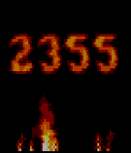
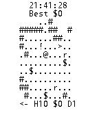

<!-- Generated by scripts/update_app_directory.py: do not edit by hand -->
[← All Pebble Developers](../developers.md)

# Jeff Lait

*2 watchfaces and 1 app · Last updated 2026-10-12 · [About these lists](../about-app-lists.md)*

Links: [Pebble App Store](https://apps.repebble.com/apps/dev/jeff-lait_52bdec2db1ce8e14c10000e7) · [GitHub (jmlaitpebble)](https://github.com/jmlaitpebble)

<button type="button" data-filter="all" aria-pressed="true">All 3</button><button type="button" data-filter="watchface" aria-pressed="false">Watchfaces 2</button><button type="button" data-filter="watchapp" aria-pressed="false">Apps 1</button>

<label class="dev-sort">Sort by <select><option value="updated">Recently updated</option><option value="released">Newest release</option><option value="title">A–Z</option></select></label>

<h2 class="app-name" id="app-556e7b93751615c64c000085"><a href="https://apps.repebble.com/556e7b93751615c64c000085">Fire Face</a> v1.0</h2>
<a class="app-source" href="https://github.com/jmlaitpebble/fireface" title="Source code" data-search-exclude>View source</a>

Watchface

No licence Released 2015-06-03 Updated 2015-06-03

Runs on: Time 2, Time

Displays the time as flames that rise and fade upwards. Yes, this will drain your battery.

<h2 class="app-name" id="app-52bdf04583ed9124110000dc"><a href="https://apps.repebble.com/52bdf04583ed9124110000dc">Rogue Watch</a> v1.0</h2>
<a class="app-source" href="https://github.com/jmlaitpebble/roguewatch" title="Source code" data-search-exclude>View source</a>

App

No licence Released 2013-12-27 Updated 2013-12-28

Runs on: Time 2, Pebble 2 Duo, Pebble 2, Time, Classic

A roguelike on your watch! H is health, D is Depth, and $ is your gold. Get as much as you can before you die!

<h2 class="app-name" id="app-52be4a7ef31c32538e000028"><a href="https://apps.repebble.com/52be4a7ef31c32538e000028">Binary Blob</a> v1.0</h2>
<a class="app-source" href="https://github.com/jmlaitpebble/binaryblob" title="Source code" data-search-exclude>View source</a>

Watchface

No licence Released 2013-12-28 Updated 2013-12-28

Runs on: Time 2, Pebble 2 Duo, Pebble 2, Time, Classic

A binary watch display with the bits drawn as metaballs. On each minute they move into a new configuration.

