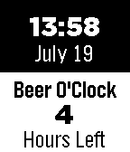

<!-- Generated by scripts/update_app_directory.py: do not edit by hand -->
[← All Pebble Developers](../developers.md)

# Jeff

*1 watchface · Last updated 2026-10-12 · [About these lists](../about-app-lists.md)*

Links: [Pebble App Store](https://apps.repebble.com/apps/dev/jeff_52e6726f14a5c963d8000025) · [GitHub (obihann)](https://github.com/obihann)

<h2 class="app-name" id="app-53cab0926c9b69335b00014f"><a href="https://apps.repebble.com/53cab0926c9b69335b00014f">Beer O&#x27;Clock</a> v1.2</h2>
<a class="app-source" href="https://github.com/obihann/Beer-O-Clock" title="Source code" data-search-exclude>View source</a>

Watchface

Released 2014-07-19 Updated 2014-07-21

Runs on: Time 2, Pebble 2 Duo, Pebble 2, Time, Classic

5PM... What is their to say? The time that we all count down until, the time we dream of, the time we ditch our suits and ties and partake in the drink of the gods, BEER! Yes, if you are a simple…

