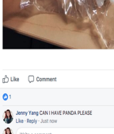

<!-- Generated by scripts/update_app_directory.py: do not edit by hand -->
[← All Pebble Developers](../developers.md)

# jenjenyang

*1 app · Last updated 2026-10-12 · [About these lists](../about-app-lists.md)*

Links: [Rebble App Store](https://apps.rebble.io/en_US/developer/59ec290c461a8d2dd0000362/1) · [GitHub (jellybellyfishmeow)](https://github.com/jellybellyfishmeow)

<h2 class="app-name" id="app-59ec41ee0dfc329496000354"><a href="https://apps.rebble.io/en_US/application/59ec41ee0dfc329496000354">helpmeh</a> v1.0</h2>
<a class="app-source" href="https://github.com/jellybellyfishmeow/t2" title="Source code" data-search-exclude>View source</a>

App

No licence Released 2017-10-22 Updated 2017-10-22 Rebble App Store

Runs on: Round 2, Time 2, Pebble 2 Duo, Pebble 2, Time Round, Time, Classic

asf

