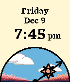

<!-- Generated by scripts/update_app_directory.py: do not edit by hand -->
[← All Pebble Developers](../developers.md)

# Jennifer Neff

*1 watchface · Last updated 2026-10-12 · [About these lists](../about-app-lists.md)*

Links: [Rebble App Store](https://apps.rebble.io/en_US/developer/54b0c3604b9e28fb69000046/1) · [GitHub (JenniferNeff)](https://github.com/JenniferNeff) · [Website (jenniferneff.com)](http://jenniferneff.com/arc_diem.php)

<h2 class="app-name" id="app-5843921800355aeb3d0008d1"><a href="https://apps.rebble.io/en_US/application/5843921800355aeb3d0008d1">Arc Diem</a> v1.2</h2>
<a class="app-source" href="https://github.com/JenniferNeff/arc-diem" title="Source code" data-search-exclude>View source</a>

Watchface

No licence Released 2016-12-04 Updated 2016-12-29 Rebble App Store

Runs on: Round 2, Time 2, Pebble 2 Duo, Pebble 2, Time Round, Time, Classic

Configure this watchface with the hour your day starts, and the hour it ends, and the hand will trace out the duration of your day and night. The design was inspired by semicircular clocks in…

