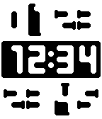

<!-- Generated by scripts/update_app_directory.py: do not edit by hand -->
[← All Pebble Developers](../developers.md)

# jennyaa

*1 watchface · Last updated 2026-10-11 · [About these lists](../about-app-lists.md)*

Links: [Rebble App Store](https://apps.rebble.io/en_US/developer/69219e2d34f4140009e9d0c0/1)

<h2 class="app-name" id="app-6935a573d865900008d04827"><a href="https://apps.rebble.io/en_US/application/6935a573d865900008d04827">Cryptic Time</a> v1.4</h2>
<a class="app-source" href="https://gitea.cloudyfy.fr/jenny/cryptic-clock" title="Source code" data-search-exclude>View source</a>

Watchface · <a href="https://forum.rebble.io/t/130" title="Discuss this app on the Rebble forum" data-search-exclude>Forum thread</a>

Released 2025-12-07 Updated 2025-12-13 Rebble App Store

Runs on: Round 2, Time 2, Pebble 2 Duo, Pebble 2, Time Round, Time

A cryptic watchface inspired by this cool wall calendar: https://www.youtube.com/watch?v=Gu62Zy4iNHA Features: - Customizable colors. - Customizable time format. For example you can choose whether…

