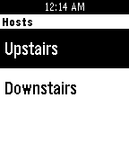

<!-- Generated by scripts/update_app_directory.py: do not edit by hand -->
[← All Pebble Developers](../developers.md)

# Jeremy Marzka

*1 app · Last updated 2026-10-11 · [About these lists](../about-app-lists.md)*

Links: [Pebble App Store](https://apps.repebble.com/apps/dev/jeremy-marzka_5574418b4604f6b33c000026) · [GitHub (jamarzka)](https://github.com/jamarzka)

<h2 class="app-name" id="app-558ed93ea6c6cce3c60000a5"><a href="https://apps.repebble.com/558ed93ea6c6cce3c60000a5">Kodi Remote</a> v1.0</h2>
<a class="app-source" href="https://github.com/jamarzka/pebble-kodi-remote" title="Source code" data-search-exclude>View source</a>

App

Released 2015-06-27 Updated 2015-06-28

Runs on: Time 2, Pebble 2 Duo, Pebble 2, Time, Classic

A simple and easy-to-use remote control for Kodi. Features: - Easy configuration for multiple devices - Separate controls for playback and navigation - Shake to Play/Pause or Select Issues: The…

