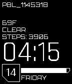

<!-- Generated by scripts/update_app_directory.py: do not edit by hand -->
[← All Pebble Developers](../developers.md)

# Jeremy Payne

*1 watchface · Last updated 2026-10-12 · [About these lists](../about-app-lists.md)*

Links: [Rebble App Store](https://apps.rebble.io/en_US/developer/68ec6fc70709b7000797e3f8/1) · [GitHub (moddedBear)](https://github.com/moddedBear)

<h2 class="app-name" id="app-6917ca9d966c150009f9bfaa"><a href="https://apps.rebble.io/en_US/application/6917ca9d966c150009f9bfaa">2077</a> v1.0</h2>
<a class="app-source" href="https://github.com/moddedBear/pebble-2077" title="Source code" data-search-exclude>View source</a>

Watchface

Released 2025-11-15 Updated 2025-11-15 Rebble App Store

Runs on: Time 2, Pebble 2 Duo, Pebble 2, Time, Classic

A futuristic watchface inspired by Cyberpunk 2077. Features: - Battery bar - Step counter - Current weather - Fully customizable top text - Hourly vibration alert - Bluetooth disconnect alert

