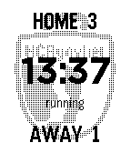

<!-- Generated by scripts/update_app_directory.py: do not edit by hand -->
[← All Pebble Developers](../developers.md)

# Jeroen Faijdherbe

*1 app · Last updated 2026-10-11 · [About these lists](../about-app-lists.md)*

Links: [Pebble App Store](https://apps.repebble.com/apps/dev/jeroen-faijdherbe_37595655433de54811d65e16) · [GitHub (faijdherbe)](https://github.com/faijdherbe)

<h2 class="app-name" id="app-6117fb58afc14c73a427c1af"><a href="https://apps.repebble.com/6117fb58afc14c73a427c1af">Sports Timer</a> v1.0.0</h2>
<a class="app-source" href="https://github.com/faijdherbe/sports-timer" title="Source code" data-search-exclude>View source</a>

App

Released 2026-09-26 Updated 2026-09-26

Runs on: Time 2, Pebble 2 Duo, Pebble 2, Time, Classic

Sports Timer is a match timer for field hockey on your wrist. It counts down each quarter and keeps the score of the home team and the away team. At 0:00 the watch vibrates, then the time counts…

