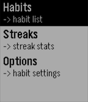

<!-- Generated by scripts/update_app_directory.py: do not edit by hand -->
[← All Pebble Developers](../developers.md)

# jerroh

*1 watchface and 1 app · Last updated 2026-10-11 · [About these lists](../about-app-lists.md)*

Links: [Rebble App Store](https://apps.rebble.io/en_US/developer/63daefc81e4c55000844f045/1) · [GitHub (jrohall)](https://github.com/jrohall)

<button type="button" data-filter="all" aria-pressed="true">All 2</button><button type="button" data-filter="watchface" aria-pressed="false">Watchfaces 1</button><button type="button" data-filter="watchapp" aria-pressed="false">Apps 1</button>

<label class="dev-sort">Sort by <select><option value="updated">Recently updated</option><option value="released">Newest release</option><option value="title">A–Z</option></select></label>

<h2 class="app-name" id="app-63fa50f863414f0009a4ca34"><a href="https://apps.rebble.io/en_US/application/63fa50f863414f0009a4ca34">Habs: A Minimal Habit Tracker</a> v1.0</h2>
<a class="app-source" href="https://github.com/jrohall/Habs" title="Source code" data-search-exclude>View source</a>

App

Released 2023-02-25 Updated 2023-02-25 Rebble App Store

Runs on: Round 2, Time 2, Pebble 2 Duo, Pebble 2, Time Round, Time, Classic

==== BETA 1.0 ==== This app is a beta release of a minimal habit tracker that allows users to set custom habits on the pebble app, which will update the pebble application. Once the user logs a…

<h2 class="app-name" id="app-63e5862363414f0008704a6e"><a href="https://apps.rebble.io/en_US/application/63e5862363414f0008704a6e">Spike Cowboy Bebop Watch Face</a> v1.1</h2>
<a class="app-source" href="https://github.com/jrohall/spike_pebble_watchface/blob/master/README.md" title="Source code" data-search-exclude>View source</a>

Watchface

Released 2023-02-09 Updated 2023-02-12 Rebble App Store

Runs on: Round 2, Time 2, Pebble 2 Duo, Pebble 2, Time Round, Time, Classic

pebble time round watchface for cowboy bebop fans!

