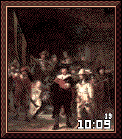

<!-- Generated by scripts/update_app_directory.py: do not edit by hand -->
[← All Pebble Developers](../developers.md)

# Jesse Linthorst

*1 watchface · Last updated 2026-11-02 · [About these lists](../about-app-lists.md)*

Links: [Pebble App Store](https://apps.repebble.com/apps/dev/jesse-linthorst_53b425a5a930985f0c78726f) · [GitHub (jesse-mm)](https://github.com/jesse-mm) · [Website (linthor.st)](https://linthor.st)

<h2 class="app-name" id="app-d89b36f0b3e247d580863764"><a href="https://apps.repebble.com/d89b36f0b3e247d580863764">NightWatch</a> v1.1.0</h2>
<a class="app-source" href="https://github.com/jesse-mm/nightwatch/" title="Source code" data-search-exclude>View source</a>

Watchface

MIT Released 2026-10-19 Updated 2026-10-27

Runs on: Round 2, Time 2, Time Round, Time

NightWatch brings centuries of fine art to your Pebble. Powered by the Rijksmuseum&#x27;s open-data collection. The watchface settings is packed with features to make it truly yours. Disclaimer…

