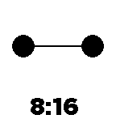

<!-- Generated by scripts/update_app_directory.py: do not edit by hand -->
[← All Pebble Developers](../developers.md)

# Jesse Millar

*7 watchfaces · Last updated 2026-10-11 · [About these lists](../about-app-lists.md)*

Links: [Pebble App Store](https://apps.repebble.com/apps/dev/jesse-millar_54305df1a2f622febf0001cc) · [GitHub (jessemillar)](https://github.com/jessemillar) · [Website (jessemillar.com)](http://www.jessemillar.com/)

<button type="button" data-filter="all" aria-pressed="true">All 7</button><button type="button" data-filter="watchface" aria-pressed="false">Watchfaces 7</button><button type="button" data-filter="watchapp" aria-pressed="false" disabled>Apps 0</button>

<label class="dev-sort">Sort by <select><option value="updated">Recently updated</option><option value="released">Newest release</option><option value="title">A–Z</option></select></label>

<h2 class="app-name" id="app-54becbb57571fb9530000075"><a href="https://apps.repebble.com/54becbb57571fb9530000075">Tuner</a> v1.2</h2>
<a class="app-source" href="https://github.com/jessemillar/Pebbling/tree/master/Tuner" title="Source code" data-search-exclude>View source</a>

Watchface

Released 2015-01-20 Updated 2015-03-29

Runs on: Time 2, Pebble 2 Duo, Pebble 2, Time, Classic

Simple dials that rotate to tell the time. Reminiscent of the smooth, sweet-feeling radio tuners of yesteryear.

<h2 class="app-name" id="app-54bd47263e50447f5d00005c"><a href="https://apps.repebble.com/54bd47263e50447f5d00005c">Adventure Time</a> v1.1</h2>
<a class="app-source" href="https://github.com/jessemillar/Pebbling/tree/master/Adventure-Time" title="Source code" data-search-exclude>View source</a>

Watchface

Released 2015-01-19 Updated 2015-01-20

Runs on: Time 2, Pebble 2 Duo, Pebble 2, Time, Classic

With Jake the Dog and Finn the Human, the fun will never end! Shake your wrist to switch characters.

<h2 class="app-name" id="app-54bd317d54845b5000000043"><a href="https://apps.repebble.com/54bd317d54845b5000000043">Jake the Dog</a> v1.0</h2>
<a class="app-source" href="https://github.com/jessemillar/Pebbling/tree/master/Jake-the-Dog" title="Source code" data-search-exclude>View source</a>

Watchface

Released 2015-01-19 Updated 2015-01-19

Runs on: Time 2, Pebble 2 Duo, Pebble 2, Time, Classic

A simple Adventure Time watchface because Jake&#x27;s the best!

<h2 class="app-name" id="app-54bd32a23e504409d5000054"><a href="https://apps.repebble.com/54bd32a23e504409d5000054">./Hacked</a> v1.0</h2>
<a class="app-source" href="https://github.com/jessemillar/Pebbling/tree/master/Hacked" title="Source code" data-search-exclude>View source</a>

Watchface

Released 2015-01-19 Updated 2015-01-19

Runs on: Time 2, Pebble 2 Duo, Pebble 2, Time, Classic

A hacked-looking watchface kinda themed after the Watchdogs videogame. &#x27;Nuff said.

<h2 class="app-name" id="app-54bc13d135ac298d8900007f"><a href="https://apps.repebble.com/54bc13d135ac298d8900007f">Half and Half</a> v1.0</h2>
<a class="app-source" href="https://github.com/jessemillar/Pebbling/tree/master/Half-and-Half" title="Source code" data-search-exclude>View source</a>

Watchface

Released 2015-01-18 Updated 2015-01-18

Runs on: Time 2, Pebble 2 Duo, Pebble 2, Time, Classic

Shows the time in an angular, simplistic way. The current hour is displayed in the center. Read current minutes as you would on an analogue clock. Shake to invert the color of the center digit.

<h2 class="app-name" id="app-54bb10e105d4ee74760000b2"><a href="https://apps.repebble.com/54bb10e105d4ee74760000b2">Hail Hydra</a> v1.0</h2>
<a class="app-source" href="https://github.com/jessemillar/Pebbling/tree/master/Hail-Hydra" title="Source code" data-search-exclude>View source</a>

Watchface

Released 2015-01-18 Updated 2015-01-18

Runs on: Time 2, Pebble 2 Duo, Pebble 2, Time, Classic

Support your favorite anti-bad-guy organization with this sporty watchface. Be warned though, things can get prickly when you shake your wrist. Hail Hydra? Hail, yeah!

<h2 class="app-name" id="app-54bb25f95efa476fee0000f4"><a href="https://apps.repebble.com/54bb25f95efa476fee0000f4">Baymax</a> v1.0</h2>
<a class="app-source" href="https://github.com/jessemillar/Pebbling/tree/master/Baymax" title="Source code" data-search-exclude>View source</a>

Watchface

Released 2015-01-18 Updated 2015-01-18

Runs on: Time 2, Pebble 2 Duo, Pebble 2, Time, Classic

A cute, Big Hero 6 companion for your watch. He blinks on occasion and even gets drunk when your Pebble is low on power.

