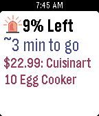
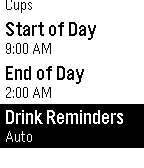
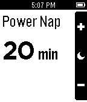

<!-- Generated by scripts/update_app_directory.py: do not edit by hand -->
[← All Pebble Developers](../developers.md)

# Jessica Yeh

*3 apps · Last updated 2026-10-12 · [About these lists](../about-app-lists.md)*

Links: [Pebble App Store](https://apps.repebble.com/apps/dev/jessica-yeh_54cbc3b00a912f754500000c) · [GitHub (JessicaYeh)](https://github.com/JessicaYeh)

<button type="button" data-filter="all" aria-pressed="true">All 3</button><button type="button" data-filter="watchface" aria-pressed="false" disabled>Watchfaces 0</button><button type="button" data-filter="watchapp" aria-pressed="false">Apps 3</button>

<label class="dev-sort">Sort by <select><option value="updated">Recently updated</option><option value="released">Newest release</option><option value="title">A–Z</option></select></label>

<h2 class="app-name" id="app-56a2cb2955a5564cb3000004"><a href="https://apps.repebble.com/56a2cb2955a5564cb3000004">WootCrap</a> v1.13</h2>
<a class="app-source" href="https://github.com/JessicaYeh/WootCrap" title="Source code" data-search-exclude>View source</a>

App

No licence Released 2016-01-23 Updated 2016-11-01

Runs on: Round 2, Time 2, Pebble 2 Duo, Pebble 2, Time Round, Time, Classic

Are you tired of missing out on Bags of Crap? With WootCrap, your house will soon be filled with cheap crap! During one of Woot’s famous Woot-Offs, just leave this app open on your Pebble and it…

<h2 class="app-name" id="app-54f15dacbc88dfd03d000028"><a href="https://apps.repebble.com/54f15dacbc88dfd03d000028">Gallon Challenge</a> v3.3</h2>
<a class="app-source" href="https://github.com/JessicaYeh/pebble-gallon-challenge" title="Source code" data-search-exclude>View source</a>

App

No licence Released 2015-02-28 Updated 2016-03-09

Runs on: Round 2, Time 2, Pebble 2 Duo, Pebble 2, Time Round, Time, Classic

Challenge yourself to drink more water for better health! Health experts recommend drinking at least a half gallon (8 cups) of water every day. Drinking enough water can help you lose weight by…

<h2 class="app-name" id="app-54cec0c362cb36cc2800003a"><a href="https://apps.repebble.com/54cec0c362cb36cc2800003a">Power Nap</a> v1.2</h2>
<a class="app-source" href="https://github.com/JessicaYeh/PebblePowerNap" title="Source code" data-search-exclude>View source</a>

App

No licence Released 2015-02-02 Updated 2015-03-05

Runs on: Time 2, Pebble 2 Duo, Pebble 2, Time, Classic

Take a power nap and be awoken by gentle vibrations. Customize the nap length to fit your schedule. New in version 1.2: Alarm now stays set if you exit the app while one is set.

