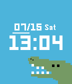

<!-- Generated by scripts/update_app_directory.py: do not edit by hand -->
[← All Pebble Developers](../developers.md)

# Jessie H.

*1 watchface · Last updated 2026-10-11 · [About these lists](../about-app-lists.md)*

Links: [Rebble App Store](https://apps.rebble.io/en_US/developer/59616fea0dfc32acc7000989/1)

<h2 class="app-name" id="app-596a38e2b67f9f43f8001e35"><a href="https://apps.rebble.io/en_US/application/596a38e2b67f9f43f8001e35">CutieGator</a> v1.0</h2>
<a class="app-source" href="https://sourceforge.net/projects/cutiegator/" title="Source code" data-search-exclude>View source</a>

Watchface

Released 2017-07-15 Updated 2017-07-15 Rebble App Store

Runs on: Round 2, Time 2, Pebble 2 Duo, Pebble 2, Time Round, Time, Classic

Wani is your wrist&#x27;s new best friend! CutieGator is a stylish watchface for the Pebble, Pebble Time, Pebble Time Round, and Pebble 2. Based off of Mari Okada&#x27;s &quot;waniwatch&quot; watchface, available…

