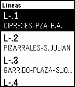

<!-- Generated by scripts/update_app_directory.py: do not edit by hand -->
[← All Pebble Developers](../developers.md)

# Jesús Merino

*1 app · Last updated 2026-10-11 · [About these lists](../about-app-lists.md)*

Links: [Pebble App Store](https://apps.repebble.com/apps/dev/jes-s-merino_558c141a295a7d265000009b) · [GitHub (jmmerino)](https://github.com/jmmerino) · [Website (busal.es)](http://busal.es)

<h2 class="app-name" id="app-562234ebb701b50286000046"><a href="https://apps.repebble.com/562234ebb701b50286000046">Busal</a> v1.3</h2>
<a class="app-source" href="https://github.com/jmmerino/busal" title="Source code" data-search-exclude>View source</a>

App

Released 2015-10-17 Updated 2015-11-02

Runs on: Time 2, Pebble 2 Duo, Pebble 2, Time, Classic

Busal es una aplicación para consultar el horario de los autobuses en Salamanca. Puedes saber el tiempo que tardará en llegar el autobus en una parada en concreto.

