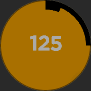

<!-- Generated by scripts/update_app_directory.py: do not edit by hand -->
[← All Pebble Developers](../developers.md)

# JGerdes

*1 app · Last updated 2026-10-11 · [About these lists](../about-app-lists.md)*

Links: [Pebble App Store](https://apps.repebble.com/apps/dev/jgerdes_56e705b3287319185e000024) · [GitHub (JGerdes)](https://github.com/JGerdes)

<h2 class="app-name" id="app-5714065395235f65eb000019"><a href="https://apps.repebble.com/5714065395235f65eb000019">Takt</a> v1.0</h2>
<a class="app-source" href="https://github.com/JGerdes/Takt" title="Source code" data-search-exclude>View source</a>

App

MIT Released 2016-04-17 Updated 2016-04-23

Runs on: Round 2, Time Round

Detect BPM (speed) of a song on your Pebble Time Round! Whether you are a DJ and/or a musician, if you want to know the beats per minute (BPM) of a song or need a steady, metronome style on-beat…

