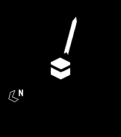

<!-- Generated by scripts/update_app_directory.py: do not edit by hand -->
[← All Pebble Developers](../developers.md)

# Jibran Iqbal

*1 app · Last updated 2026-10-12 · [About these lists](../about-app-lists.md)*

Links: [Pebble App Store](https://apps.repebble.com/apps/dev/jibran-iqbal_69aa1c09dece040009f8eeb2) · [GitHub (jibraniqbal666)](https://github.com/jibraniqbal666)

<h2 class="app-name" id="app-69aaf1e62f1bed0009deb65b"><a href="https://apps.repebble.com/69aaf1e62f1bed0009deb65b">Qibla - Prayer Times &amp; Compass (NEW)</a> v2.11</h2>
<a class="app-source" href="https://github.com/jibraniqbal666/pebble-qibla" title="Source code" data-search-exclude>View source</a>

App · <a href="https://forum.rebble.io/t/821" title="Discuss this app on the Rebble forum" data-search-exclude>Forum thread</a>

No licence Released 2026-03-06 Updated 2026-06-15

Runs on: Round 2, Time 2, Pebble 2 Duo, Pebble 2, Time Round, Time, Classic

Prayer times &amp; notifications on your Timeline, plus a Qibla compass for your Pebble. Automatically calculates prayer times based on your location - so make sure &quot;location services&quot; is enabled on…

