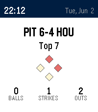

<!-- Generated by scripts/update_app_directory.py: do not edit by hand -->
[← All Pebble Developers](../developers.md)

# Jimmy Timmons

*1 watchface · Last updated 2026-10-11 · [About these lists](../about-app-lists.md)*

Links: [Pebble App Store](https://apps.repebble.com/apps/dev/jimmy-timmons_f97aa2549a33d05d7825987f) · [GitHub (jimmytimmons)](https://github.com/jimmytimmons)

<h2 class="app-name" id="app-17d9e63004874c0b9755c1bc"><a href="https://apps.repebble.com/17d9e63004874c0b9755c1bc">Baseball Scores</a> v1.0.0</h2>
<a class="app-source" href="https://github.com/jimmytimmons/pebble-baseball" title="Source code" data-search-exclude>View source</a>

Watchface

Released 2026-06-03 Updated 2026-06-03

Runs on: Time 2

Live MLB scores on your wrist. Baseball Scores auto-cycles through up to three of your favorite teams, showing the live score, base runners, the ball-strike-out count, and the inning. On off-days…

