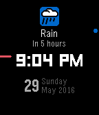

<!-- Generated by scripts/update_app_directory.py: do not edit by hand -->
[← All Pebble Developers](../developers.md)

# jjv360

*1 watchface and 2 apps · Last updated 2026-10-12 · [About these lists](../about-app-lists.md)*

Links: [Pebble App Store](https://apps.repebble.com/apps/dev/jjv360_52e0dde67487e523520000da) · [Rebble App Store](https://apps.rebble.io/en_US/developer/52e0dde67487e523520000da/1) · [GitHub (jjv360)](https://github.com/jjv360)

<button type="button" data-filter="all" aria-pressed="true">All 3</button><button type="button" data-filter="watchface" aria-pressed="false">Watchfaces 1</button><button type="button" data-filter="watchapp" aria-pressed="false">Apps 2</button>

<label class="dev-sort">Sort by <select><option value="updated">Recently updated</option><option value="released">Newest release</option><option value="title">A–Z</option></select></label>

<h2 class="app-name" id="app-52e7b8ee217dd0e5bc00000f"><a href="https://apps.repebble.com/52e7b8ee217dd0e5bc00000f">uTorrent Remote</a> v1.1.3</h2>
<a class="app-source" href="https://github.com/jjv360/uTorrent-Pebble" title="Source code" data-search-exclude>View source</a>

App

No licence Released 2014-01-28 Updated 2025-11-25

Runs on: Time 2, Pebble 2 Duo, Pebble 2, Time, Classic

A simple remote control for uTorrent. Features: - List of torrents - View size, speed and ETA - Progress bar to quickly see download progress - Start and stop torrents

<h2 class="app-name" id="app-56d2bac4d4f5886fb100000a"><a href="https://apps.rebble.io/en_US/application/56d2bac4d4f5886fb100000a">Sal</a> v2.3</h2>
<a class="app-source" href="https://github.com/jjv360/Sal-Pebble" title="Source code" data-search-exclude>View source</a>

App

No licence Released 2016-02-28 Updated 2017-06-04 Rebble App Store

Runs on: Round 2, Time 2, Pebble 2 Duo, Pebble 2, Time Round, Time

Sal is a personal AI assistant for your Pebble. Features: - Speak to Sal via the Pebble&#x27;s built-in microphone - Downloadable plugins stored on the phone for faster responses - Answers general…

<h2 class="app-name" id="app-574b3bb45810563b2400001c"><a href="https://apps.repebble.com/574b3bb45810563b2400001c">InfoWatch</a> v1.02</h2>
<a class="app-source" href="https://github.com/jjv360/InfoWatch" title="Source code" data-search-exclude>View source</a>

Watchface

No licence Released 2016-05-29 Updated 2016-06-02

Runs on: Round 2, Time 2, Pebble 2 Duo, Pebble 2, Time Round, Time, Classic

A minimalist watchface that shows your next upcoming event. Currently supported event types: - Battery (low battery, charging, charge complete) - Bluetooth connection (disconnected) - Weather…

