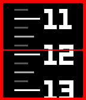
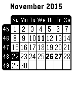
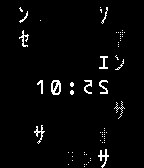

<!-- Generated by scripts/update_app_directory.py: do not edit by hand -->
[← All Pebble Developers](../developers.md)

# Jnm

*13 watchfaces and 1 app · Last updated 2026-10-11 · [About these lists](../about-app-lists.md)*

Links: [Pebble App Store](https://apps.repebble.com/apps/dev/jnm_529994c0e627ce7ba1000050) · [GitHub (Jnmattern)](https://github.com/Jnmattern) · [Website (download.famillemattern.com)](http://download.famillemattern.com/public/pebble/Upright/)

<button type="button" data-filter="all" aria-pressed="true">All 14</button><button type="button" data-filter="watchface" aria-pressed="false">Watchfaces 13</button><button type="button" data-filter="watchapp" aria-pressed="false">Apps 1</button>

<label class="dev-sort">Sort by <select><option value="updated">Recently updated</option><option value="released">Newest release</option><option value="title">A–Z</option></select></label>

<h2 class="app-name" id="app-52da7ee9889f5dade50000fc"><a href="https://apps.repebble.com/52da7ee9889f5dade50000fc">Ruler Watch Reloaded</a> v3.16</h2>
<a class="app-source" href="https://github.com/Jnmattern/RulerWatchReloaded" title="Source code" data-search-exclude>View source</a>

Watchface · <a href="https://forum.rebble.io/t/1389" title="Discuss this app on the Rebble forum" data-search-exclude>Forum thread</a>

No licence Released 2014-01-18 Updated 2026-09-29

Runs on: Round 2, Time 2, Pebble 2 Duo, Pebble 2, Time Round, Time, Classic

Time is displayed using a ruler that scrolls as time goes by. Configuration Screen allows to invert colors &amp; enable/disable vibration on hour. Time is displayed using a ruler that scrolls as time…

<h2 class="app-name" id="app-52a207a0a38509f36600003c"><a href="https://apps.repebble.com/52a207a0a38509f36600003c">Clipped</a> v3.2</h2>
<a class="app-source" href="https://github.com/Jnmattern/Clipped_2.0" title="Source code" data-search-exclude>View source</a>

Watchface

No licence Released 2013-12-06 Updated 2026-03-02

Runs on: Round 2, Time 2, Pebble 2 Duo, Pebble 2, Time Round, Time, Classic

Huge digits that do not fit in the screen! Versions Available : date/nodate, day/month, month/day, and week day in Danish, Dutch, English, French, German, Italien, Spanish or Swedish, minutes in…

<h2 class="app-name" id="app-52bdadff83ed912a860000a1"><a href="https://apps.repebble.com/52bdadff83ed912a860000a1">Arc</a> v3.3</h2>
<a class="app-source" href="https://github.com/Jnmattern/Arc_2.0" title="Source code" data-search-exclude>View source</a>

Watchface

No licence Released 2013-12-27 Updated 2026-03-02

Runs on: Round 2, Time 2, Pebble 2 Duo, Pebble 2, Time Round, Time, Classic

Simple design watchface showing hour and minutes. Tap or twist your wrist to sequentially display the date, the battery percentage, the phone connection status and the time in digits. Use the…

<h2 class="app-name" id="app-52999773129af794a2000052"><a href="https://apps.repebble.com/52999773129af794a2000052">BlockSlide</a> v3.20</h2>
<a class="app-source" href="https://github.com/Jnmattern/Blockslide" title="Source code" data-search-exclude>View source</a>

Watchface · <a href="https://forum.rebble.io/t/358" title="Discuss this app on the Rebble forum" data-search-exclude>Forum thread</a>

No licence Released 2013-11-30 Updated 2026-03-01

Runs on: Round 2, Time 2, Pebble 2 Duo, Pebble 2, Time Round, Time, Classic

Now also available in color for Pebble Time! Simple and eye catching display with some kind of twist when digits change! Display is configurable from the Pebble Phone App, where you can choose the…

<h2 class="app-name" id="app-52bdb232dc2f4ff50f00009a"><a href="https://apps.repebble.com/52bdb232dc2f4ff50f00009a">PCal</a> v3.5</h2>
<a class="app-source" href="https://github.com/Jnmattern/PCal" title="Source code" data-search-exclude>View source</a>

App

No licence Released 2013-12-27 Updated 2016-02-17

Runs on: Round 2, Time 2, Pebble 2 Duo, Pebble 2, Time Round, Time, Classic

Universal Calendar, configuration screen available from the Phone Pebble App, allowing to set language, display of week numbers, first day of week and public holidays for some countries. Available…

<h2 class="app-name" id="app-52da82cd889f5dc9eb00010a"><a href="https://apps.repebble.com/52da82cd889f5dc9eb00010a">Snowy</a> v1.3</h2>
<a class="app-source" href="https://github.com/Jnmattern/Snowy" title="Source code" data-search-exclude>View source</a>

Watchface

No licence Released 2014-01-18 Updated 2015-11-26

Runs on: Round 2, Time 2, Pebble 2 Duo, Pebble 2, Time Round, Time, Classic

Watch the snow gently falling!

<h2 class="app-name" id="app-5581da399e9090386400000b"><a href="https://apps.repebble.com/5581da399e9090386400000b">Fire!</a> v1.0</h2>
<a class="app-source" href="https://github.com/Jnmattern/Fire" title="Source code" data-search-exclude>View source</a>

Watchface

No licence Released 2015-06-17 Updated 2015-06-17

Runs on: Time 2, Time

Want to see how hot your Pebble Time can be? Install Fire! and contemplate your Pebble while it&#x27;s melting down! The developer is not responsible for 3rd-degree burns and empty batteries :)

<h2 class="app-name" id="app-5564ab23421e8451aa00008a"><a href="https://apps.repebble.com/5564ab23421e8451aa00008a">Upright</a> v1.0</h2>
<a class="app-source" href="https://github.com/Jnmattern/Upright" title="Source code" data-search-exclude>View source</a>

Watchface

No licence Released 2015-05-26 Updated 2015-05-26

Runs on: Time 2, Pebble 2 Duo, Pebble 2, Time, Classic

Don&#x27;t bother with gravity anymore! The watch knows! Don&#x27;t bend your elbow to show the time, the time rotates to be always upright!

<h2 class="app-name" id="app-53fb8d2f858af2f826000040"><a href="https://apps.repebble.com/53fb8d2f858af2f826000040">BlockSlide-Seconds 2.0</a> v2.0</h2>
<a class="app-source" href="https://github.com/Jnmattern/Blockslide-Seconds_2.0" title="Source code" data-search-exclude>View source</a>

Watchface

No licence Released 2014-08-25 Updated 2014-08-25

Runs on: Time 2, Pebble 2 Duo, Pebble 2, Time, Classic

An animation is worth a thousand words. No settings, raw flavor! Oh: animation is accelerated ;oP

<h2 class="app-name" id="app-52da8234227cbe482b000120"><a href="https://apps.repebble.com/52da8234227cbe482b000120">Perspective</a> v1.1.3</h2>
<a class="app-source" href="https://github.com/Jnmattern/Perspective" title="Source code" data-search-exclude>View source</a>

Watchface

No licence Released 2014-01-18 Updated 2014-06-28

Runs on: Time 2, Pebble 2 Duo, Pebble 2, Time, Classic

The time is displayed using small dots in a 3D fashion. The screen refreshes 10 times per second depending on the accelerometer. Yes, this is surely a battery-sucker! Configuration screen allows…

<h2 class="app-name" id="app-5311af3492295d8d8800003b"><a href="https://apps.repebble.com/5311af3492295d8d8800003b">MatrixCode 2.0</a> v2.0.2</h2>
<a class="app-source" href="https://github.com/Jnmattern/MatrixCode_2.0" title="Source code" data-search-exclude>View source</a>

Watchface

No licence Released 2014-03-01 Updated 2014-03-01

Runs on: Time 2, Pebble 2 Duo, Pebble 2, Time, Classic

Matrix inspired watchface. Settings allow to configure the use of straight or reversed digits and blinking colon.

<h2 class="app-name" id="app-52e0f32a7487e58289000182"><a href="https://apps.repebble.com/52e0f32a7487e58289000182">Minimalist 2.0</a> v2.0.4</h2>
<a class="app-source" href="https://github.com/Jnmattern/Minimalist_2.0" title="Source code" data-search-exclude>View source</a>

Watchface

No licence Released 2014-01-23 Updated 2014-02-11

Runs on: Time 2, Pebble 2 Duo, Pebble 2, Time, Classic

Minimalist display combining analog and digital time. Configuration screen allows to choose between minutes at the hour hand position, hours at the minute hand position, and hours &amp; minutes at the…

<h2 class="app-name" id="app-52e0ed6dd8561d962b00010f"><a href="https://apps.repebble.com/52e0ed6dd8561d962b00010f">TH10 2.0</a> v1.0.0</h2>
<a class="app-source" href="https://github.com/Jnmattern/TH10-Date_2.0" title="Source code" data-search-exclude>View source</a>

Watchface

No licence Released 2014-01-23 Updated 2014-01-23

Runs on: Time 2, Pebble 2 Duo, Pebble 2, Time, Classic

Analog watch with day of month inspired by the Torgoen T10 Original 1.x version by Hudson.

<h2 class="app-name" id="app-52e0f023d8561d30c5000120"><a href="https://apps.repebble.com/52e0f023d8561d30c5000120">PolarMap 2.0</a> v1.0.0</h2>
<a class="app-source" href="https://github.com/Jnmattern/PolarMap_2.0" title="Source code" data-search-exclude>View source</a>

Watchface

No licence Released 2014-01-23 Updated 2014-01-23

Runs on: Time 2, Pebble 2 Duo, Pebble 2, Time, Classic

Watchface displaying a rotating earth polar map. Original 1.x version by Hudson.

