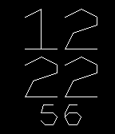

<!-- Generated by scripts/update_app_directory.py: do not edit by hand -->
[← All Pebble Developers](../developers.md)

# Joakim Lundborg

*1 watchface · Last updated 2026-10-11 · [About these lists](../about-app-lists.md)*

Links: [Pebble App Store](https://apps.repebble.com/apps/dev/joakim-lundborg_54ca4775c967f9a436000018) · [GitHub (cortex)](https://github.com/cortex) · [Website (lundborg.io)](http://lundborg.io)

<h2 class="app-name" id="app-54e92432caaeb247b20000b9"><a href="https://apps.repebble.com/54e92432caaeb247b20000b9">Vector Morph</a> v1.0</h2>
<a class="app-source" href="http://github.com/cortex/pebble-morph" title="Source code" data-search-exclude>View source</a>

Watchface

No licence Released 2015-02-22 Updated 2015-02-22

Runs on: Time 2, Pebble 2 Duo, Pebble 2, Time, Classic

Tell the time with oldschool arcade vectors. Hand-coded font with smooth animated transitions.

