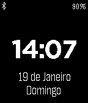

<!-- Generated by scripts/update_app_directory.py: do not edit by hand -->
[← All Pebble Developers](../developers.md)

# João Luís

*1 watchface · Last updated 2026-10-11 · [About these lists](../about-app-lists.md)*

Links: [Pebble App Store](https://apps.repebble.com/apps/dev/jo-o-lu-s_52cfd1031d006dc01700000e) · [GitHub (joaopluis)](https://github.com/joaopluis)

<h2 class="app-name" id="app-52fb7da13f98abae960000eb"><a href="https://apps.repebble.com/52fb7da13f98abae960000eb">A Portuguesa</a> v1.1.2</h2>
<a class="app-source" href="https://github.com/joaopluis/A-Portuguesa" title="Source code" data-search-exclude>View source</a>

Watchface

Released 2014-02-12 Updated 2014-03-07

Runs on: Time 2, Pebble 2 Duo, Pebble 2, Time, Classic

A simple watchface I designed, mainly because I wanted one in Portuguese. It shows the time, the date, the weekday, the connection status and the battery status. It is named after the Portuguese…

