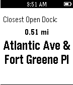

<!-- Generated by scripts/update_app_directory.py: do not edit by hand -->
[← All Pebble Developers](../developers.md)

# Joe Masilotti

*1 app · Last updated 2026-10-11 · [About these lists](../about-app-lists.md)*

Links: [Pebble App Store](https://apps.repebble.com/apps/dev/joe-masilotti_52a92b8179c18fd92c000005) · [GitHub (joemasilotti)](https://github.com/joemasilotti)

<h2 class="app-name" id="app-52ab113cb8f6c20e31000019"><a href="https://apps.repebble.com/52ab113cb8f6c20e31000019">PebCiti - NYC CitiBike and London Barclays Cycle Hire</a> v2.0</h2>
<a class="app-source" href="https://github.com/joemasilotti/PebCiti" title="Source code" data-search-exclude>View source</a>

App

Released 2013-12-13 Updated 2015-01-31

Runs on: Time 2, Pebble 2 Duo, Pebble 2, Time, Classic

A simple, open-source app to show the nearest available bike share dock or bike on your Pebble. New York City&#x27;s CitiBike and London&#x27;s Barclays Cycle Hire are currently supported.

