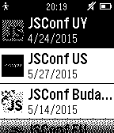

<!-- Generated by scripts/update_app_directory.py: do not edit by hand -->
[← All Pebble Developers](../developers.md)

# Joel Lovera

*1 app · Last updated 2026-10-11 · [About these lists](../about-app-lists.md)*

Links: [Pebble App Store](https://apps.repebble.com/apps/dev/joel-lovera_547357817b10bb366d000064) · [GitHub (loverajoel)](https://github.com/loverajoel)

<h2 class="app-name" id="app-54ebb991b0a2e249e20000e9"><a href="https://apps.repebble.com/54ebb991b0a2e249e20000e9">JsConf</a> v0.1</h2>
<a class="app-source" href="https://github.com/loverajoel/jsconf-pebble" title="Source code" data-search-exclude>View source</a>

App

Released 2015-02-23 Updated 2015-02-23

Runs on: Time 2, Pebble 2 Duo, Pebble 2, Time, Classic

- Events - Talks - Info Beta version Open source project

