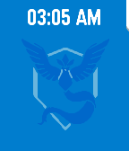

<!-- Generated by scripts/update_app_directory.py: do not edit by hand -->
[← All Pebble Developers](../developers.md)

# Joey Tuong

*1 watchface and 1 app · Last updated 2026-10-12 · [About these lists](../about-app-lists.md)*

Links: [Pebble App Store](https://apps.repebble.com/apps/dev/joey-tuong_558210aa389bccce8500003b) · [GitHub (tetrapus)](https://github.com/tetrapus)

<button type="button" data-filter="all" aria-pressed="true">All 2</button><button type="button" data-filter="watchface" aria-pressed="false">Watchfaces 1</button><button type="button" data-filter="watchapp" aria-pressed="false">Apps 1</button>

<label class="dev-sort">Sort by <select><option value="updated">Recently updated</option><option value="released">Newest release</option><option value="title">A–Z</option></select></label>

<h2 class="app-name" id="app-5796959aa40d829e7b00001e"><a href="https://apps.repebble.com/5796959aa40d829e7b00001e">PokeWatch</a> v1.4</h2>
<a class="app-source" href="https://github.com/tetrapus/PoGoPebble" title="Source code" data-search-exclude>View source</a>

Watchface

Released 2016-07-25 Updated 2016-08-01

Runs on: Time 2, Time

Hunt nearby Pokemon and show off your team colours! Check out the settings page to set your team and customise alerts. PokeWatch will vibrate when a new pokemon appears and show nearby pokemon…

<h2 class="app-name" id="app-5798e5b11482cdda2b0000c8"><a href="https://apps.repebble.com/5798e5b11482cdda2b0000c8">PokeHunt</a> v1.4</h2>
<a class="app-source" href="https://github.com/tetrapus/PoGoPebble/tree/watchapp" title="Source code" data-search-exclude>View source</a>

App

Released 2016-07-27 Updated 2016-08-01

Runs on: Time 2, Time

Hunt down nearby Pokemon! See directions to Pokemon around you, get notified when new ones pop up, and represent your team! Check out the settings page to customise your team and change your…

