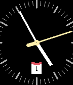
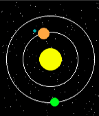

<!-- Generated by scripts/update_app_directory.py: do not edit by hand -->
[← All Pebble Developers](../developers.md)

# Johannes Arnold

*2 watchfaces · Last updated 2026-10-12 · [About these lists](../about-app-lists.md)*

Links: [Pebble App Store](https://apps.repebble.com/apps/dev/johannes-arnold_55cba60d184220976c00009e) · [GitHub (j0hax)](https://github.com/j0hax)

<button type="button" data-filter="all" aria-pressed="true">All 2</button><button type="button" data-filter="watchface" aria-pressed="false">Watchfaces 2</button><button type="button" data-filter="watchapp" aria-pressed="false" disabled>Apps 0</button>

<label class="dev-sort">Sort by <select><option value="updated">Recently updated</option><option value="released">Newest release</option><option value="title">A–Z</option></select></label>

<h2 class="app-name" id="app-55e9cf5892115a698c00002e"><a href="https://apps.repebble.com/55e9cf5892115a698c00002e">Braun</a> v3.30</h2>
<a class="app-source" href="https://github.com/j0hax/Braun" title="Source code" data-search-exclude>View source</a>

Watchface

No licence Released 2015-09-04 Updated 2016-11-15

Runs on: Round 2, Time 2, Time Round, Time

Less is More: A readable, yet stylish Watchface paying tribute to the legendary design of Dieter Rams and Dietrich Lubs. Now with improved look and support for Pebble Round and Time 2!

<h2 class="app-name" id="app-55f2457fb3b7025e5e00004b"><a href="https://apps.repebble.com/55f2457fb3b7025e5e00004b">Solar</a> v1.2</h2>
<a class="app-source" href="https://github.com/j0hax/Solar" title="Source code" data-search-exclude>View source</a>

Watchface

No licence Released 2015-09-11 Updated 2015-09-11

Runs on: Time 2, Time

A minimalistic watchface that displays the time using two planets orbiting a sun.

