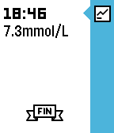

<!-- Generated by scripts/update_app_directory.py: do not edit by hand -->
[← All Pebble Developers](../developers.md)

# John Costik

*1 watchface · Last updated 2026-10-11 · [About these lists](../about-app-lists.md)*

Links: [Pebble App Store](https://apps.repebble.com/apps/dev/john-costik_52f910e662c1d7aa0d0003a6) · [GitHub (hackingtype1)](https://github.com/hackingtype1) · [Website (nightscout.info)](http://www.nightscout.info/wiki/labs/pebble-pebble-time-watchface-wshare-support)

<h2 class="app-name" id="app-557c3091d269ce13b300001a"><a href="https://apps.repebble.com/557c3091d269ce13b300001a">Simple CGM</a> v2.5</h2>
<a class="app-source" href="https://github.com/hackingtype1/cgm-pebble-time-wf" title="Source code" data-search-exclude>View source</a>

Watchface

Released 2015-06-13 Updated 2019-07-24

Runs on: Round 2, Time 2, Pebble 2 Duo, Pebble 2, Time Round, Time, Classic

View CGM data. This app is not supported or endorsed by Dexcom. Simple CGM MUST NOT BE USED TO MAKE MEDICAL DECISIONS. THERE IS NO WARRANTY FOR THE PROGRAM, TO THE EXTENT PERMITTED BY APPLICABLE…

