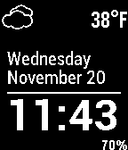

<!-- Generated by scripts/update_app_directory.py: do not edit by hand -->
[← All Pebble Developers](../developers.md)

# John Flanagan

*1 watchface · Last updated 2026-10-11 · [About these lists](../about-app-lists.md)*

Links: [Pebble App Store](https://apps.repebble.com/apps/dev/john-flanagan_52b201b58c0815ed4900002a) · [GitHub (tallerthenyou)](https://github.com/tallerthenyou)

<h2 class="app-name" id="app-52b31f92b70e1c2c77000121"><a href="https://apps.repebble.com/52b31f92b70e1c2c77000121">Simple Weather</a> v1.3</h2>
<a class="app-source" href="https://github.com/tallerthenyou/simplicity-with-day" title="Source code" data-search-exclude>View source</a>

Watchface

Released 2013-12-19 Updated 2016-02-09

Runs on: Time 2, Pebble 2 Duo, Pebble 2, Time, Classic

Simplicity based watchface with weather and battery level.

