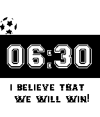

<!-- Generated by scripts/update_app_directory.py: do not edit by hand -->
[← All Pebble Developers](../developers.md)

# John Gehl

*1 watchface · Last updated 2026-10-11 · [About these lists](../about-app-lists.md)*

Links: [Pebble App Store](https://apps.repebble.com/apps/dev/john-gehl_53a30d0e7ff27b07b700019f) · [GitHub (iliketocode)](https://github.com/iliketocode)

<h2 class="app-name" id="app-53ac45dfe9ecad8c19000037"><a href="https://apps.repebble.com/53ac45dfe9ecad8c19000037">GOAL</a> v1.6</h2>
<a class="app-source" href="https://github.com/iliketocode/GOAL" title="Source code" data-search-exclude>View source</a>

Watchface

Released 2014-06-26 Updated 2014-06-28

Runs on: Time 2, Pebble 2 Duo, Pebble 2, Time, Classic

A watchface inspired by the world cup. Every time the minute changes, then the soccer ball does a little animation and the time says GOAL. Also does the animation when you shake your Pebble. Based…

