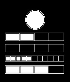

<!-- Generated by scripts/update_app_directory.py: do not edit by hand -->
[← All Pebble Developers](../developers.md)

# John Hammond

*1 watchface · Last updated 2026-10-12 · [About these lists](../about-app-lists.md)*

Links: [Pebble App Store](https://apps.repebble.com/apps/dev/john-hammond_557457774604f6bd68000037)

<h2 class="app-name" id="app-55aaa4c6609cd536c10000b5"><a href="https://apps.repebble.com/55aaa4c6609cd536c10000b5">Berlin Clock</a> v1.0</h2>
<a class="app-source" href="http://pastebin.com/GCvt4MJt" title="Source code" data-search-exclude>View source</a>

Watchface

Released 2015-07-18 Updated 2015-07-18

Runs on: Time 2, Pebble 2 Duo, Pebble 2, Time, Classic

The Berlin Clock, on your wrist! From Wikipedia... Telling the time based on the &quot;set theory principle&quot;, the Mengenlehreuhr (Berlin Clock) consists of 24 lights which are divided into one circular…

