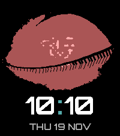
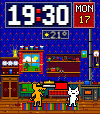
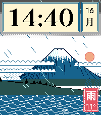

<!-- Generated by scripts/update_app_directory.py: do not edit by hand -->
[← All Pebble Developers](../developers.md)

# John Metsn

*3 watchfaces · Last updated 2026-11-23 · [About these lists](../about-app-lists.md)*

Links: [Pebble App Store](https://apps.repebble.com/apps/dev/john-metsn_bbd41e47283443f524575102) · [GitHub (JohnMetsn)](https://github.com/JohnMetsn)

<button type="button" data-filter="all" aria-pressed="true">All 3</button><button type="button" data-filter="watchface" aria-pressed="false">Watchfaces 3</button><button type="button" data-filter="watchapp" aria-pressed="false" disabled>Apps 0</button>

<label class="dev-sort">Sort by <select><option value="updated">Recently updated</option><option value="released">Newest release</option><option value="title">A–Z</option></select></label>

<h2 class="app-name" id="app-363ab94be8474e259b7bd7e5"><a href="https://apps.repebble.com/363ab94be8474e259b7bd7e5">Look at me!</a> v1.0.0</h2>
<a class="app-source" href="https://github.com/JohnMetsn/look-at-me" title="Source code" data-search-exclude>View source</a>

Watchface

Other Released 2026-11-19 Updated 2026-11-19

Runs on: Round 2, Time 2

A realistic eye sleeps on your wrist. When you raise your wrist to look, it wakes up: the lids flutter, the eye opens, glances around, and then finds you. The pupil widens as it locks on, and from…

<h2 class="app-name" id="app-d4255cc5bf9d4b8a9840d935"><a href="https://apps.repebble.com/d4255cc5bf9d4b8a9840d935">Pejsek a Kočička</a> v1.0.0</h2>
<a class="app-source" href="https://github.com/JohnMetsn/pejsek-a-kocicka" title="Source code" data-search-exclude>View source</a>

Watchface

MIT Released 2026-11-18 Updated 2026-11-18

Runs on: Round 2, Time 2

Pejsek a Kočička (&quot;Doggy and Kitty&quot;) are two friends from Josef Čapek&#x27;s 1929 Czech children&#x27;s book. On your wrist they live their day next to a big, bold clock. Raise your wrist and they act out…

<h2 class="app-name" id="app-263a3c2f3d1f4dd49305a365"><a href="https://apps.repebble.com/263a3c2f3d1f4dd49305a365">Kasumi</a> v1.0.3</h2>
<a class="app-source" href="https://github.com/JohnMetsn/kasumi" title="Source code" data-search-exclude>View source</a>

Watchface

MIT Released 2026-11-16 Updated 2026-11-18

Runs on: Round 2, Time 2

Kasumi turns the weather into a woodblock print. There are no icons and no numbers to decode: a single Mount Fuji, after Hokusai&#x27;s Thirty-six Views of Mount Fuji, is repainted by the weather and…

