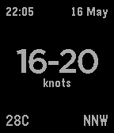

<!-- Generated by scripts/update_app_directory.py: do not edit by hand -->
[← All Pebble Developers](../developers.md)

# John O&\#x27;Nolan

*1 app · Last updated 2026-10-12 · [About these lists](../about-app-lists.md)*

Links: [Pebble App Store](https://apps.repebble.com/apps/dev/john-o-nolan_554ea0d7ff168d98830000b3) · [GitHub (JohnONolan)](https://github.com/JohnONolan)

<h2 class="app-name" id="app-5557a371809acd83c1000019"><a href="https://apps.repebble.com/5557a371809acd83c1000019">Wind Watch</a> v1.0</h2>
<a class="app-source" href="https://github.com/JohnONolan/windwatch" title="Source code" data-search-exclude>View source</a>

App

No licence Released 2015-05-16 Updated 2015-05-16

Runs on: Time 2, Pebble 2 Duo, Pebble 2, Time, Classic

Wind Watch is a very simple app which provides live streaming data from the Kiteboarding Club El Gouna weather station in Egypt.

