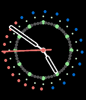

<!-- Generated by scripts/update_app_directory.py: do not edit by hand -->
[← All Pebble Developers](../developers.md)

# John Preston

*1 watchface · Last updated 2026-10-12 · [About these lists](../about-app-lists.md)*

Links: [Pebble App Store](https://apps.repebble.com/apps/dev/john-preston_56534f1b28a791aea70000b8) · [GitHub (wcerfgba)](https://github.com/wcerfgba)

<h2 class="app-name" id="app-5663225bfa1c04975d000072"><a href="https://apps.repebble.com/5663225bfa1c04975d000072">HebrewTime</a> v3.0</h2>
<a class="app-source" href="https://github.com/wcerfgba/HebrewTime" title="Source code" data-search-exclude>View source</a>

Watchface

Released 2015-12-05 Updated 2015-12-12

Runs on: Round 2, Time 2, Time Round, Time

A Hebrew hour is defined as 1/12th of the time between sunset and sunrise, or 1/12th of the time between sunrise and sunset. This is a analogue watchface for Pebble smartwatches that shows the…

