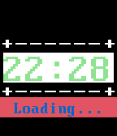

<!-- Generated by scripts/update_app_directory.py: do not edit by hand -->
[← All Pebble Developers](../developers.md)

# john rodriguez

*1 watchface · Last updated 2026-10-11 · [About these lists](../about-app-lists.md)*

Links: [Rebble App Store](https://apps.rebble.io/en_US/developer/5657e96bc7fedc25e8000047/1)

<h2 class="app-name" id="app-5800568e2cde65bfb70002d9"><a href="https://apps.rebble.io/en_US/application/5800568e2cde65bfb70002d9">Simple 2</a> v1.0</h2>
<a class="app-source" href="https://cloudpebble.net/ide/project/321649#" title="Source code" data-search-exclude>View source</a>

Watchface

Released 2016-10-14 Updated 2017-07-12 Rebble App Store

Runs on: Round 2, Time 2, Pebble 2 Duo, Pebble 2, Time Round, Time, Classic

simple 2

