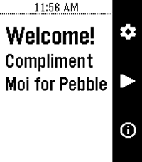

<!-- Generated by scripts/update_app_directory.py: do not edit by hand -->
[← All Pebble Developers](../developers.md)

# John Spahr

*1 app · Last updated 2026-10-11 · [About these lists](../about-app-lists.md)*

Links: [Rebble App Store](https://apps.rebble.io/en_US/developer/60a3f01d1342ae0091b7e184/1) · [GitHub (johnspahr)](https://github.com/johnspahr) · [Website (tectrasystems.org)](https://tectrasystems.org)

<h2 class="app-name" id="app-60a3f01f1342ae0091b7e186"><a href="https://apps.rebble.io/en_US/application/60a3f01f1342ae0091b7e186">Compliment Moi</a> v1.2</h2>
<a class="app-source" href="https://github.com/johnspahr/compliment-moi-pebble" title="Source code" data-search-exclude>View source</a>

App

Released 2021-05-18 Updated 2021-05-20 Rebble App Store

Runs on: Round 2, Time 2, Pebble 2 Duo, Pebble 2, Time Round, Time, Classic

Feeling gloomy? If so, perhaps a compliment will brighten up your day! Compliment Moi is a simple little Pebble.js app that compliments you and gives you words of encouragement. With tons of…

