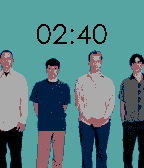
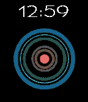
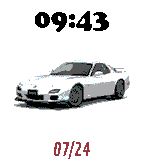
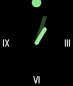

<!-- Generated by scripts/update_app_directory.py: do not edit by hand -->
[← All Pebble Developers](../developers.md)

# John Spahr

*9 watchfaces and 3 apps · Last updated 2026-10-12 · [About these lists](../about-app-lists.md)*

Links: [Rebble App Store](https://apps.rebble.io/en_US/developer/609801a58324660009e8a4db/1) · [GitHub (johnspahr)](https://github.com/johnspahr) · [Website (johnspahr.org)](https://johnspahr.org)

<button type="button" data-filter="all" aria-pressed="true">All 12</button><button type="button" data-filter="watchface" aria-pressed="false">Watchfaces 9</button><button type="button" data-filter="watchapp" aria-pressed="false">Apps 3</button>

<label class="dev-sort">Sort by <select><option value="updated">Recently updated</option><option value="released">Newest release</option><option value="title">A–Z</option></select></label>

<h2 class="app-name" id="app-6293cf9e98768d00095a945f"><a href="https://apps.rebble.io/en_US/application/6293cf9e98768d00095a945f">Laptopman Face 2.0</a> v2.2</h2>
<a class="app-source" href="https://github.com/johnspahr/laptopmanface" title="Source code" data-search-exclude>View source</a>

Watchface

CC0-1.0 Released 2022-05-29 Updated 2022-11-22 Rebble App Store

Runs on: Round 2, Time 2, Pebble 2 Duo, Pebble 2, Time Round, Time, Classic

Meet the new (and improved) Laptopman Face, a watchface featuring a guy with laptop for a head! This updated version introduces a more readable font and a battery meter. Be careful, though, as…

<h2 class="app-name" id="app-637920b8c6c24a000a815e61"><a href="https://apps.rebble.io/en_US/application/637920b8c6c24a000a815e61">Activities</a> v1.0</h2>
<a class="app-source" href="https://github.com/johnspahr/pebbleactivities" title="Source code" data-search-exclude>View source</a>

App

CC0-1.0 Released 2022-11-19 Updated 2022-11-19 Rebble App Store

Runs on: Round 2, Time 2, Pebble 2 Duo, Pebble 2, Time Round, Time, Classic

Feeling bored? This little PebbleJS app uses the Bored API to suggest activities for you to do! Activities are selected based on the number of participants you choose. Created for Rebble Hackathon…

<h2 class="app-name" id="app-6377c82fc6c24a000a815e53"><a href="https://apps.rebble.io/en_US/application/6377c82fc6c24a000a815e53">weezeface</a> v1.0</h2>
<a class="app-source" href="https://github.com/johnspahr/weezeface" title="Source code" data-search-exclude>View source</a>

Watchface

CC0-1.0 Released 2022-11-18 Updated 2022-11-18 Rebble App Store

Runs on: Round 2, Time 2, Pebble 2 Duo, Pebble 2, Time Round, Time, Classic

The world’s first Weezer watchface for Pebble! Switches between the blue and red album covers depending on your BT connection status. This project was submitted for Rebble’s first hackathon! Be…

<h2 class="app-name" id="app-636f0be6fdf3e30009f6394b"><a href="https://apps.rebble.io/en_US/application/636f0be6fdf3e30009f6394b">Disintegration</a> v1.1</h2>
<a class="app-source" href="https://github.com/johnspahr/pebbletemplate" title="Source code" data-search-exclude>View source</a>

Watchface

CC0-1.0 Released 2022-11-12 Updated 2022-11-12 Rebble App Store

Runs on: Round 2, Time 2, Time Round, Time

Simple face based on the classic Disintegration album cover by The Cure.

<h2 class="app-name" id="app-62e976e4e595b3000a939a31"><a href="https://apps.rebble.io/en_US/application/62e976e4e595b3000a939a31">Blue Monday &#x27;88</a> v1.1</h2>
<a class="app-source" href="https://github.com/JohnSpahr/BlueMondayFace" title="Source code" data-search-exclude>View source</a>

Watchface

CC0-1.0 Released 2022-08-02 Updated 2022-08-02 Rebble App Store

Runs on: Round 2, Time 2, Time Round, Time

Simple face based on New Order&#x27;s classic Blue Monday &#x27;88 cover.

<h2 class="app-name" id="app-62d07e79635baa0009d782b9"><a href="https://apps.rebble.io/en_US/application/62d07e79635baa0009d782b9">Pet Sounds</a> v1.3</h2>
<a class="app-source" href="https://github.com/johnspahr/petsoundsface" title="Source code" data-search-exclude>View source</a>

Watchface

CC0-1.0 Released 2022-07-14 Updated 2022-07-25 Rebble App Store

Runs on: Round 2, Time 2, Time Round, Time

A simple watch face based on the album cover of The Beach Boys&#x27; &quot;Pet Sounds.&quot; This face was requested by fellow Pebbler Twebe Bebe on Discord. Anyway, enjoy!

<h2 class="app-name" id="app-62ddf692bcc333000908d28d"><a href="https://apps.rebble.io/en_US/application/62ddf692bcc333000908d28d">Mazda RX7</a> v1.0</h2>
<a class="app-source" href="https://github.com/johnspahr/mazdarx7face" title="Source code" data-search-exclude>View source</a>

Watchface

CC0-1.0 Released 2022-07-25 Updated 2022-07-25 Rebble App Store

Runs on: Round 2, Time 2, Time Round, Time

Pebble Time watch face that randomly displays a few different pictures of a Mazda RX7, the date, and the time. Watchface requested by Twebe Bebe of Pebblebot Repairs. (Be sure to check it out!)

<h2 class="app-name" id="app-62b22a46b4b75900091ae637"><a href="https://apps.rebble.io/en_US/application/62b22a46b4b75900091ae637">Cupertino (Updated)</a> v1.3</h2>
<a class="app-source" href="https://github.com/johnspahr/cupertinoface" title="Source code" data-search-exclude>View source</a>

Watchface

CC0-1.0 Released 2022-06-21 Updated 2022-06-21 Rebble App Store

Runs on: Round 2, Time 2, Pebble 2 Duo, Pebble 2, Time Round, Time

A simple and elegant analog watchface with optional date and plenty of other customization options. Built with RockyJS. Note: This is an updated version of an existing face I released here that…

<h2 class="app-name" id="app-62964f20b4b75900091ae62a"><a href="https://apps.rebble.io/en_US/application/62964f20b4b75900091ae62a">Cupertino</a> v1.2</h2>
<a class="app-source" href="https://github.com/johnspahr/cupertinoface" title="Source code" data-search-exclude>View source</a>

Watchface

CC0-1.0 Released 2022-05-31 Updated 2022-06-12 Rebble App Store

Runs on: Round 2, Time 2, Time Round, Time

A simple and elegant analog watchface with optional date and plenty of other customization options. Built with RockyJS.

<h2 class="app-name" id="app-626b1ef27ca61400094ed7e4"><a href="https://apps.rebble.io/en_US/application/626b1ef27ca61400094ed7e4">Laptopman Face (Classic)</a> v1.4</h2>
<a class="app-source" href="https://github.com/JohnSpahr/LaptopmanFace" title="Source code" data-search-exclude>View source</a>

Watchface

CC0-1.0 Released 2022-04-28 Updated 2022-05-22 Rebble App Store

Runs on: Time 2, Pebble 2 Duo, Pebble 2, Time, Classic

Good news! I&#x27;ve released an updated version of this face with a couple of new features. However, I&#x27;ll be keeping this one around if you prefer the old style. Meet the Laptopman, a simple Pebble…

<h2 class="app-name" id="app-628ab49ce3ac04000b00b97f"><a href="https://apps.rebble.io/en_US/application/628ab49ce3ac04000b00b97f">Compliment Moi (Updated)</a> v1.3</h2>
<a class="app-source" href="https://github.com/JohnSpahr/compliment-moi-pebble" title="Source code" data-search-exclude>View source</a>

App

CC0-1.0 Released 2022-05-22 Updated 2022-05-22 Rebble App Store

Runs on: Round 2, Time 2, Pebble 2 Duo, Pebble 2, Time Round, Time, Classic

Feeling gloomy? If so, perhaps a compliment will brighten up your day! Compliment Moi is a simple little Pebble.js app that compliments you and gives you words of encouragement. With tons of…

<h2 class="app-name" id="app-60a3f01f1342ae0091b7e186"><a href="https://apps.rebble.io/en_US/application/60a3f01f1342ae0091b7e186">Compliment Moi</a> v1.2</h2>
<a class="app-source" href="https://github.com/johnspahr/compliment-moi-pebble" title="Source code" data-search-exclude>View source</a>

App

CC0-1.0 Released 2021-05-18 Updated 2021-05-20 Rebble App Store

Runs on: Round 2, Time 2, Pebble 2 Duo, Pebble 2, Time Round, Time, Classic

Feeling gloomy? If so, perhaps a compliment will brighten up your day! Compliment Moi is a simple little Pebble.js app that compliments you and gives you words of encouragement. With tons of…

