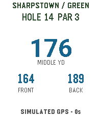

<!-- Generated by scripts/update_app_directory.py: do not edit by hand -->
[← All Pebble Developers](../developers.md)

# john suh

*1 app · Last updated 2026-11-09 · [About these lists](../about-app-lists.md)*

Links: [Pebble App Store](https://apps.repebble.com/apps/dev/john-suh_f80d6845cf278b4a8ff625f1) · [GitHub (j5uh)](https://github.com/j5uh)

<h2 class="app-name" id="app-9e3c0aa8c35a40d3ac5bbed3"><a href="https://apps.repebble.com/9e3c0aa8c35a40d3ac5bbed3">Fairway Finder</a> v1.0.1</h2>
<a class="app-source" href="https://github.com/j5uh/pebble-watch-golf" title="Source code" data-search-exclude>View source</a>

App

Other Released 2026-11-02 Updated 2026-11-02

Runs on: Round 2, Time 2

Golf GPS yardages on your wrist, for Pebble Round 2 and Pebble Time 2. - Front, middle and back of the green, plus a layup target that leaves your preferred distance. - Reach and carry yardages…

