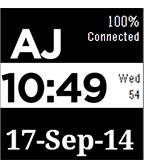

<!-- Generated by scripts/update_app_directory.py: do not edit by hand -->
[← All Pebble Developers](../developers.md)

# Johnny Dunhin

*1 watchface · Last updated 2026-10-11 · [About these lists](../about-app-lists.md)*

Links: [Pebble App Store](https://apps.repebble.com/apps/dev/johnny-dunhin_52be95796ecafe8fe0000045) · [Website (dunhindevelopers.wordpress.com)](http://dunhindevelopers.wordpress.com)

<h2 class="app-name" id="app-54194fe6019321e332000151"><a href="https://apps.repebble.com/54194fe6019321e332000151">AJ Pebble Face</a> v2.0</h2>
<a class="app-source" href="http://dunhindevelopers.wordpress.com/2014/09/17/aj-pebble-face/" title="Source code" data-search-exclude>View source</a>

Watchface

Released 2014-09-17 Updated 2014-09-18

Runs on: Time 2, Pebble 2 Duo, Pebble 2, Time, Classic

Personal touch to my Pebble. Source code is on website.

