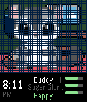

<!-- Generated by scripts/update_app_directory.py: do not edit by hand -->
[← All Pebble Developers](../developers.md)

# Joho Software

*1 app · Last updated 2026-11-09 · [About these lists](../about-app-lists.md)*

Links: [Pebble App Store](https://apps.repebble.com/apps/dev/joho-software_fff3f577a126f422d571b0e6) · [GitHub (johosoft0)](https://github.com/johosoft0) · [Website (pages.jocoworkshop.com)](https://pages.jocoworkshop.com/joho-pebble.html)

<h2 class="app-name" id="app-5198a3a797fe41ee984ee795"><a href="https://apps.repebble.com/5198a3a797fe41ee984ee795">MyBuddy Sugar Glider (classic)</a> v0.5</h2>
<a class="app-source" href="https://github.com/johosoft0/mybuddy_virtual_pet" title="Source code" data-search-exclude>View source</a>

App

No licence Released 2026-04-09 Updated 2026-04-16

Runs on: Round 2, Time 2, Time Round, Time

Have your own cute little Suggie living on your wrist! Enjoy her every day. Keep her fed and happy. - Simple setup, no settings screen - Pick your suggie&#x27;s name when you first start - Day/night is…

