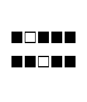

<!-- Generated by scripts/update_app_directory.py: do not edit by hand -->
[← All Pebble Developers](../developers.md)

# Johtull

*1 watchface · Last updated 2026-10-12 · [About these lists](../about-app-lists.md)*

Links: [Pebble App Store](https://apps.repebble.com/apps/dev/johtull_5553e2ef64e9b70277000086)

<h2 class="app-name" id="app-555ab9b19cace258f700006e"><a href="https://apps.repebble.com/555ab9b19cace258f700006e">Simple Binary Clock</a> v1.1</h2>
<a class="app-source" href="http://pastebin.com/cDtkS8Fi" title="Source code" data-search-exclude>View source</a>

Watchface

Released 2015-05-19 Updated 2015-05-22

Runs on: Time 2, Pebble 2 Duo, Pebble 2, Time, Classic

Basic binary clock. Top row = hours in base 2, bottom row = minutes in base 2. Empty boxes are zeros, filled boxes are ones. 24-hour format. Colors invert between 6pm and 6am.

