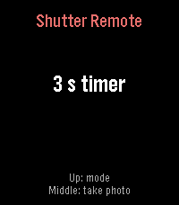

<!-- Generated by scripts/update_app_directory.py: do not edit by hand -->
[← All Pebble Developers](../developers.md)

# Jojo

*1 app · Last updated 2026-11-09 · [About these lists](../about-app-lists.md)*

Links: [Pebble App Store](https://apps.repebble.com/apps/dev/jojo_eb23ae5ec6d10103aba71379) · [GitHub (jojo-pebble)](https://github.com/jojo-pebble)

<h2 class="app-name" id="app-9353cecbb0ad4cb2ab3e4011"><a href="https://apps.repebble.com/9353cecbb0ad4cb2ab3e4011">Shutter Remote</a> v1.1.0</h2>
<a class="app-source" href="https://github.com/jojo-pebble/shutter-remote" title="Source code" data-search-exclude>View source</a>

App

MIT Released 2026-10-27 Updated 2026-10-27

Runs on: Time 2

Shutter Remote lets you take photos with your phone&#x27;s built-in camera straight from your Pebble Time 2. Open the camera on your phone, press the middle button on your watch to take a photo right…

