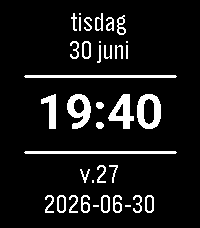

<!-- Generated by scripts/update_app_directory.py: do not edit by hand -->
[← All Pebble Developers](../developers.md)

# jole84

*1 watchface · Last updated 2026-10-11 · [About these lists](../about-app-lists.md)*

Links: [Pebble App Store](https://apps.repebble.com/apps/dev/jole84_36face5c2d9f7d232d52d02e) · [GitHub (jole84)](https://github.com/jole84)

<h2 class="app-name" id="app-a47c8da6501f43bb936edbfb"><a href="https://apps.repebble.com/a47c8da6501f43bb936edbfb">Enkel Svensk klocka</a> v1.0.1</h2>
<a class="app-source" href="https://github.com/jole84/swe-watchface" title="Source code" data-search-exclude>View source</a>

Watchface

Released 2026-06-30 Updated 2026-07-01

Runs on: Round 2, Time 2

Swedish watchface for Pebble Time 2 and Round 2 written in javascript. Inspired by SweWeek from chrobe.

