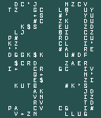
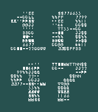

<!-- Generated by scripts/update_app_directory.py: do not edit by hand -->
[← All Pebble Developers](../developers.md)

# jomapp

*2 watchfaces · Last updated 2026-10-11 · [About these lists](../about-app-lists.md)*

Links: [Pebble App Store](https://apps.repebble.com/apps/dev/jomapp_49944f6d520b4d28b5720a05) · [GitHub (jomapp)](https://github.com/jomapp)

<button type="button" data-filter="all" aria-pressed="true">All 2</button><button type="button" data-filter="watchface" aria-pressed="false">Watchfaces 2</button><button type="button" data-filter="watchapp" aria-pressed="false" disabled>Apps 0</button>

<label class="dev-sort">Sort by <select><option value="updated">Recently updated</option><option value="released">Newest release</option><option value="title">A–Z</option></select></label>

<h2 class="app-name" id="app-f5aa8a5e6f9d457d848ee408"><a href="https://apps.repebble.com/f5aa8a5e6f9d457d848ee408">E2EE Clock (Old Pebbles)</a> v1.0.0</h2>
<a class="app-source" href="https://github.com/jomapp/pebbleface-e2ee-clock" title="Source code" data-search-exclude>View source</a>

Watchface

Released 2026-04-06 Updated 2026-04-06

Runs on: Time 2, Pebble 2 Duo, Pebble 2, Time, Classic

Simple watchface featuring an &quot;end-to-end encrypted&quot; (E2EE) style clock! Bold Aesthetic: Four striking digits rendered through a random ciphertext effect. 🔐 I created this watchface to raise…

<h2 class="app-name" id="app-bc53387be05547889beabe73"><a href="https://apps.repebble.com/bc53387be05547889beabe73">E2EE Clock</a> v1.0.0</h2>
<a class="app-source" href="https://github.com/jomapp/pebbleface-e2ee-clock" title="Source code" data-search-exclude>View source</a>

Watchface

Released 2026-04-06 Updated 2026-04-06

Runs on: Round 2, Time 2

Simple watchface featuring an &quot;end-to-end encrypted&quot; (E2EE) style clock! Bold Aesthetic: Four striking digits rendered through a random ciphertext effect. 🔐 Smooth Motion: Easily configurable with…

