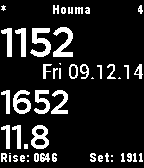

<!-- Generated by scripts/update_app_directory.py: do not edit by hand -->
[← All Pebble Developers](../developers.md)

# Jon

*1 watchface · Last updated 2026-10-11 · [About these lists](../about-app-lists.md)*

Links: [Pebble App Store](https://apps.repebble.com/apps/dev/jon_539b2cf9a394e6ef7800002f)

<h2 class="app-name" id="app-540758e6451ee9acdf000187"><a href="https://apps.repebble.com/540758e6451ee9acdf000187">Pilot&#x27;s Zulu Time</a> v0.69</h2>
<a class="app-source" href="http://www.jonrussell.xyz/projects/Pebble/watchface/ZuluTime/" title="Source code" data-search-exclude>View source</a>

Watchface

Released 2014-09-03 Updated 2016-08-22

Runs on: Time 2, Pebble 2 Duo, Pebble 2, Time, Classic

A simple text watchface that shows local and Zulu/GMT time. Features -Local Time -Zulu Time -Decimal Time (Optional to display) -Date -Day/Night Coloring -Bluetooth Connection Status -Battery %…

