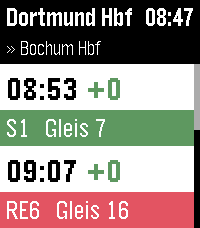

<!-- Generated by scripts/update_app_directory.py: do not edit by hand -->
[← All Pebble Developers](../developers.md)

# jonathan-1414

*1 app · Last updated 2026-11-02 · [About these lists](../about-app-lists.md)*

Links: [Pebble App Store](https://apps.repebble.com/apps/dev/jonathan-1414_7ca6ae46f357261ed57052ea) · [GitHub (jonathan-1414)](https://github.com/jonathan-1414)

<h2 class="app-name" id="app-079328fadc7d42ed98854a5d"><a href="https://apps.repebble.com/079328fadc7d42ed98854a5d">Von A nach B</a> v0.2.0</h2>
<a class="app-source" href="https://github.com/jonathan-1414/von-a-nach-b" title="Source code" data-search-exclude>View source</a>

App

MIT Released 2026-10-27 Updated 2026-10-29

Runs on: Time 2

Abfahrtsmonitor für Direktverbindungen, unabhängig vom aktuellen Standort. Bei großen Bahnhöfen lassen sich so genau die Verbindungen herausfiltern, die man benötigt. Für gespeicherte Verbindungen…

