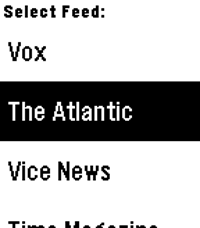

<!-- Generated by scripts/update_app_directory.py: do not edit by hand -->
[← All Pebble Developers](../developers.md)

# Jonathan Alland

*1 app · Last updated 2026-10-11 · [About these lists](../about-app-lists.md)*

Links: [Rebble App Store](https://apps.rebble.io/en_US/developer/5d8d503bc393f5215a13e5e4/1) · [GitHub (Wowfunhappy)](https://github.com/Wowfunhappy)

<h2 class="app-name" id="app-5d8d503bc393f5215a13e5e6"><a href="https://apps.rebble.io/en_US/application/5d8d503bc393f5215a13e5e6">RSS Reader</a> v2.0</h2>
<a class="app-source" href="https://github.com/Wowfunhappy/Pebble-RSS-Reader" title="Source code" data-search-exclude>View source</a>

App

GPL-3.0 Released 2019-09-26 Updated 2020-02-14 Rebble App Store

Runs on: Round 2, Time 2, Pebble 2 Duo, Pebble 2, Time Round, Time, Classic

Hands full? No problem! As long as you have a Pebble smartwatch and at least one free finger, you can read the news--no pulling out your phone required. Pebble RSS Reader is the only way to read…

