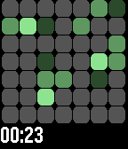

<!-- Generated by scripts/update_app_directory.py: do not edit by hand -->
[← All Pebble Developers](../developers.md)

# Jonathan Salomo

*2 watchfaces · Last updated 2026-10-11 · [About these lists](../about-app-lists.md)*

Links: [Pebble App Store](https://apps.repebble.com/apps/dev/jonathan-salomo_67a740be89529e0008dfd3da) · [GitHub (Apfelholz)](https://github.com/Apfelholz)

<button type="button" data-filter="all" aria-pressed="true">All 2</button><button type="button" data-filter="watchface" aria-pressed="false">Watchfaces 2</button><button type="button" data-filter="watchapp" aria-pressed="false" disabled>Apps 0</button>

<label class="dev-sort">Sort by <select><option value="updated">Recently updated</option><option value="released">Newest release</option><option value="title">A–Z</option></select></label>

<h2 class="app-name" id="app-6977b6735cd4fc00092489cb"><a href="https://apps.repebble.com/6977b6735cd4fc00092489cb">Fuzzy Glucose</a> v1.1</h2>
<a class="app-source" href="https://github.com/Apfelholz/Fuzzy-Glucose" title="Source code" data-search-exclude>View source</a>

Watchface · <a href="https://forum.rebble.io/t/577" title="Discuss this app on the Rebble forum" data-search-exclude>Forum thread</a>

No licence Released 2026-01-26 Updated 2026-01-28

Runs on: Time 2, Pebble 2 Duo, Pebble 2, Time, Classic

This version keeps the main fuzzy time display from the original and adds info layers at the top and bottom of the screen for additional information including for glucose data from the LibreLinkUp…

<h2 class="app-name" id="app-67ce34d2b7a0230391426cbe"><a href="https://apps.repebble.com/67ce34d2b7a0230391426cbe">github-contributions</a> v1.3</h2>
<a class="app-source" href="https://github.com/Apfelholz/github-contributions-watchface" title="Source code" data-search-exclude>View source</a>

Watchface

Apache-2.0 Released 2025-03-10 Updated 2025-03-27

Runs on: Time 2, Pebble 2 Duo, Pebble 2, Time, Classic

A Pebble watchface that dynamically changes its background color based on your GitHub contributions.

