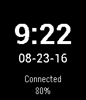
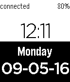

<!-- Generated by scripts/update_app_directory.py: do not edit by hand -->
[← All Pebble Developers](../developers.md)

# Jonathan Wukitsch

*2 watchfaces · Last updated 2026-10-11 · [About these lists](../about-app-lists.md)*

Links: [Pebble App Store](https://apps.repebble.com/apps/dev/jonathan-wukitsch_549df32c112793b38500040b) · [GitHub (insleep)](https://github.com/insleep) · [Website (insleep.tech)](https://insleep.tech/)

<button type="button" data-filter="all" aria-pressed="true">All 2</button><button type="button" data-filter="watchface" aria-pressed="false">Watchfaces 2</button><button type="button" data-filter="watchapp" aria-pressed="false" disabled>Apps 0</button>

<label class="dev-sort">Sort by <select><option value="updated">Recently updated</option><option value="released">Newest release</option><option value="title">A–Z</option></select></label>

<h2 class="app-name" id="app-54b84f4e986a2267770000ca"><a href="https://apps.repebble.com/54b84f4e986a2267770000ca">Ice</a> v1.31</h2>
<a class="app-source" href="https://github.com/insleep/IceWatchface-Pebble/" title="Source code" data-search-exclude>View source</a>

Watchface

Released 2015-01-15 Updated 2025-11-25

Runs on: Round 2, Time 2, Pebble 2 Duo, Pebble 2, Time Round, Time, Classic

A simple watchface that tells the time, date, battery percentage, and whether or not Bluetooth is connected. Supports 12 and 24hr time format.

<h2 class="app-name" id="app-54acaf6132203e7e6700003d"><a href="https://apps.repebble.com/54acaf6132203e7e6700003d">Sky</a> v3.0</h2>
<a class="app-source" href="https://github.com/insleep/SkyWatchface-Pebble/" title="Source code" data-search-exclude>View source</a>

Watchface

Released 2015-01-07 Updated 2016-09-05

Runs on: Round 2, Time 2, Pebble 2 Duo, Pebble 2, Time Round, Time, Classic

A simple watchface that tells time, date, day of the week, battery percentage, and whether or not Bluetooth is connected. Available in 12 and 24 hour format.

