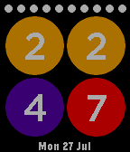

<!-- Generated by scripts/update_app_directory.py: do not edit by hand -->
[← All Pebble Developers](../developers.md)

# Jonathon Lundy

*1 watchface · Last updated 2026-10-12 · [About these lists](../about-app-lists.md)*

Links: [Pebble App Store](https://apps.repebble.com/apps/dev/jonathon-lundy_557f322d71b570794600005b) · [GitHub (jon-lundy)](https://github.com/jon-lundy)

<h2 class="app-name" id="app-55b6f9731802644be9000023"><a href="https://apps.repebble.com/55b6f9731802644be9000023">Bullets</a> v1.1</h2>
<a class="app-source" href="https://github.com/jon-lundy/pebble-bullets" title="Source code" data-search-exclude>View source</a>

Watchface

Released 2015-07-28 Updated 2015-08-04

Runs on: Time 2, Time

In printed text, a bullet refers to a heavy dot. In this watchface, bullets will show you the time and your battery level. - A different colored bullet for every digit. - Toggle between 12 and 24…

