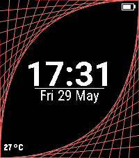

<!-- Generated by scripts/update_app_directory.py: do not edit by hand -->
[← All Pebble Developers](../developers.md)

# jonny

*1 watchface and 1 app · Last updated 2026-10-12 · [About these lists](../about-app-lists.md)*

Links: [Pebble App Store](https://apps.repebble.com/apps/dev/jonny_5d5ba1411aa8f6110d6f9c64) · [GitHub (JonnyKreng)](https://github.com/JonnyKreng)

<button type="button" data-filter="all" aria-pressed="true">All 2</button><button type="button" data-filter="watchface" aria-pressed="false">Watchfaces 1</button><button type="button" data-filter="watchapp" aria-pressed="false">Apps 1</button>

<label class="dev-sort">Sort by <select><option value="updated">Recently updated</option><option value="released">Newest release</option><option value="title">A–Z</option></select></label>

<h2 class="app-name" id="app-e5e4d6c0ecbd44b980379456"><a href="https://apps.repebble.com/e5e4d6c0ecbd44b980379456">Navi App</a> v1.1.10</h2>
<a class="app-source" href="https://github.com/JonnyKreng/pebble-navi" title="Source code" data-search-exclude>View source</a>

App · <a href="https://forum.rebble.io/t/1058" title="Discuss this app on the Rebble forum" data-search-exclude>Forum thread</a>

Other Released 2026-06-07 Updated 2026-07-12

Runs on: Round 2, Time 2, Pebble 2 Duo, Pebble 2, Time Round, Time

Welcome to Pebble Navi - Turn-by-turn navigation on your wrist - Support walking, driving and cycling modes - Destination selection from saved locations - Save current location - Supports Pebble…

<h2 class="app-name" id="app-70abca87163d49debbf6cbc5"><a href="https://apps.repebble.com/70abca87163d49debbf6cbc5">Parabola</a> v1.0.7</h2>
<a class="app-source" href="https://github.com/JonnyKreng/PebbleParabolaWatchface" title="Source code" data-search-exclude>View source</a>

Watchface

MIT Released 2026-05-29 Updated 2026-06-05

Runs on: Round 2, Time 2, Pebble 2 Duo

Just a little watchface, i build for fun. For the Time 2, on older watches it does not look great.

